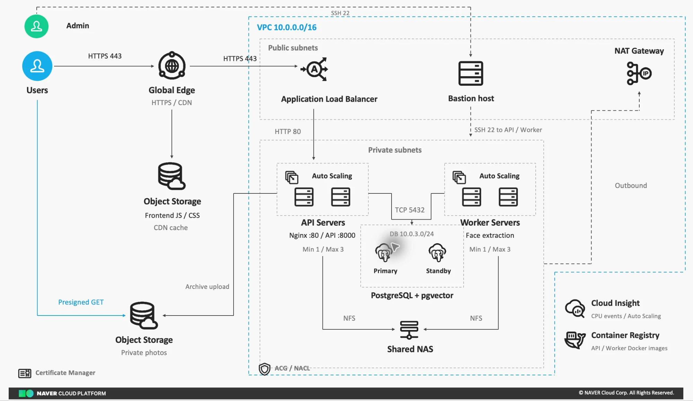

# 인생내컷 (face-based-photo-sorter)

행사 사진을 얼굴별로 자동 분류하고, 참가자가 셀카 한 장으로 자기 사진만 찾아 내려받는 웹서비스.

서비스 주소(현재 운영 중단): https://findmyphoto.remotewire.net

(본 프로젝트는 네이버 클라우드 리터러시 교육 프로젝트로, 클라우드 인프라 설계에 집중했음을 알린다.
운영 프로젝트가 아님으로 admin 계정 1개로 고정, 사람 얼굴 인식 모델 최적화 등에서 실제 운영에 필요한 추가 작업이 필요하다.)

## 1. 서비스 개요

행사 사진 수백 장 속에서 내가 나온 사진을 찾으려면 하나하나 넘겨 봐야 한다. 
인생내컷은 사진더미를 올리기만 하면 자동으로 사람들을 분류해 사람 별 폴더 형식으로 제공한다.

```
[관리자] 행사 만들기 → 사진 업로드 → 업로드 완료
                                   ↓
[서버]   얼굴 찾기 → 사람별로 묶기 → 사진 보관 → 공개
                                   ↓
[참가자] 인증코드·QR로 입장 → 셀카 촬영 → 내 사진 폴더 → 저장·공유
```

| 사용자 | 할 수 있는 것 |
|---|---|
| 관리자 | 행사 생성(인증코드·QR 발급), 사진 업로드, 정리 진행 상황 확인, 분류 결과 확인 |
| 참가자 | 인증코드·QR로 입장, 셀카로 내 사진 폴더 찾기, 사람별·전체 사진 보기, 여러 장 저장·공유 |

- 셀카는 서버에 저장하지 않고, 사진은 만료 시간(1시간)이 있는 주소로만 제공해요.
- 휴대폰(아이폰 Safari·안드로이드 Chrome)과 PC 화면을 모두 지원해요.

## 2. 기술 스택

| 영역 | 기술 |
|---|---|
| 프론트엔드 | React 19, TypeScript, Vite, React Router, Tailwind CSS, shadcn/ui, MSW(가짜 API), Vitest |
| 백엔드 | Python 3.12, FastAPI, SQLAlchemy 2, uv, pytest |
| 얼굴 분석 | InsightFace `buffalo_l` (얼굴 검출·512차원 벡터), SciPy (계층적 군집) |
| DB | PostgreSQL 16 + pgvector (얼굴 벡터 검색, 작업 대기열) |
| 인프라 (NCP) | Global Edge, Application Load Balancer, Auto Scaling, Cloud DB for PostgreSQL, NAS, Object Storage, Container Registry, Cloud Insight, Certificate Manager |
| 배포 | Docker (API·워커 이미지), Nginx |

## 3. 역할 분담

| 역할 | 담당 |
|---|---|
| 백엔드 1: [@najunho04](https://github.com/najunho04) | 공통 기반(설정·인증·DB 모델), 행사·사진 업로드, 사람 분류, 사진 보관·공개, 사진 조회 API, 배포 이미지 |
| 백엔드 2: [@bo0npiece ](https://github.com/bo0npiece ) | 얼굴 찾기 워커(검출·벡터 추출), 셀카 매칭 API |
| 프론트엔드: [@jeongho30 ](https://github.com/jeongho30 ) | 참가자·관리자 화면 전체, 가짜 API, 디자인 시스템 |
| 인프라: [@d0ubleho](https://github.com/d0ubleho) | NCP 아키텍처 설계·구축, 배포, 자동 확장, 부하 테스트 |

## 4. 아키텍처



- 사용자는 HTTPS 도메인 하나로 화면과 API를 함께 쓴다 (Global Edge → Load Balancer → Nginx → API).
- API 서버와 워커(얼굴 찾기)를 나눠 각각 Auto Scaling을 적용한다.
- API와 워커는 서로 호출하지 않고 **DB(PostgreSQL)와 공유 NAS로만** 주고받는다. SQS같은 리소스가 네이버 클라우드에서 지원중단한 관계로 DB를 통해 워커들의 병렬처리 충돌을 방지한다.
- 사진은 비공개 Object Storage에 두고, API가 발급한 서명 URL로만 제공한다. 

자세한 구성과 검증 결과는 [docs/deployment.md](docs/deployment.md).

## 5. ERD · API

**ERD** — [docs/erd.md](docs/erd.md)

| 테이블 | 내용 |
|---|---|
| `events` | 행사 (이름, 인증코드, 상태 `uploading → extracting → clustering → open`) |
| `photos` | 사진 (NAS 경로, Object Storage 위치, 처리 상태). 상태 값이 워커의 작업 대기열 역할 |
| `faces` | 사진 속 얼굴 (위치, 512차원 벡터, 어느 사람인지) |
| `persons` | 분류된 사람 (이름, 대표 벡터, 대표 얼굴) |

**API** — [docs/api.md](docs/api.md)

| 대상 | API |
|---|---|
| 관리자 | 1 로그인 · 2 행사 생성 · 3 사진 업로드 · 4 업로드 완료 · 5 진행 상황 |
| 참가자 | 6 입장 · 7 전체 사진 · 8 셀카 매칭 · 9 사람 폴더 사진 · 10 사람 폴더 목록 |

## 6. 백엔드 · 프론트 · 배포

**백엔드** — [backend/README.md](backend/README.md)

API 서버(API 1~10 + 분류 스케줄러), 워커(얼굴 찾기), DB 세 개로 돌아간다. 주요 기능, 로컬 실행 방법, 실험 결과가 있다.

```bash
cd backend
uv sync && cp .env.example .env
docker compose up -d                          # DB
uv run uvicorn main:application --reload      # API 서버 + 분류 스케줄러 (http://localhost:8000/docs)
uv run python -m extraction.worker            # 워커
```

**프론트엔드** — [frontend/README.md](frontend/README.md)

백엔드 없이도 가짜 API로 모든 화면을 확인할 수 있다. 개발 계획과 결정 기록은 [frontend/docs/frontend-dev-plan.md](frontend/docs/frontend-dev-plan.md), 디자인 명세는 [MASTER.md](frontend/docs/design-system/insaengnaecut/MASTER.md).

```bash
cd frontend
npm install
npm run dev
```

**배포** — [docs/deployment.md](docs/deployment.md)

NCP 구성 요소, Docker 이미지 빌드·실행, 설정값, 자동 확장 정책, 기능·부하 테스트 결과.
