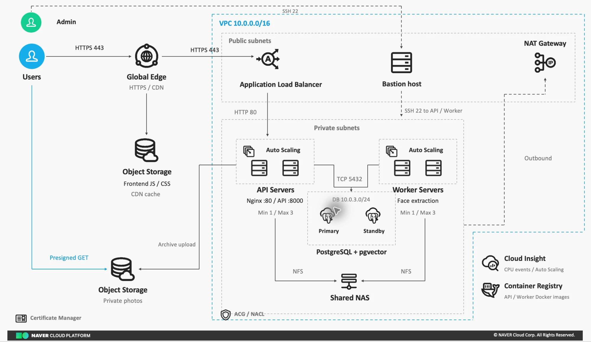

# 배포

> NCP(네이버 클라우드 플랫폼)에 배포한 구성과 배포 방법, 검증 결과.
> 백엔드 실행 구성은 [backend/README.md](../backend/README.md), API는 [api.md](api.md), DB는 [erd.md](erd.md)를 기준으로 해요.

서비스 주소: `https://findmyphoto.remotewire.net`



## 1. 요청이 지나가는 길

| 요청 | 경로 | 비고 |
|---|---|---|
| 화면 HTML (첫 화면·관리자·행사 페이지) | 사용자 → Global Edge → ALB → Nginx | SPA 경로(`/e/*`, `/admin/*`)도 Nginx가 처리 |
| 정적 JS·CSS (`/assets/*`) | 사용자 → Global Edge → 프론트 Object Storage | CDN 캐시 |
| API (`/api/*`) | 사용자 → Global Edge → ALB → Nginx → API 컨테이너 | 캐시 우회 |
| 사진 업로드 | 사용자 → API → 공유 NAS | 워커가 NAS에서 읽어 얼굴 추출 |
| 공개된 사진 조회·저장 | API가 발급한 서명 URL → 사진 Object Storage | 버킷은 비공개, 제한 시간 동안만 GET 허용 |

화면과 API가 같은 HTTPS 도메인이라 백엔드 CORS 설정이 필요 없어요.

| 구간 | 프로토콜·포트 |
|---|---|
| 사용자 → Global Edge → ALB | HTTPS 443 |
| ALB → API 서버 Nginx | HTTP 80 |
| Nginx → API 컨테이너 | HTTP 8000 (`127.0.0.1:8000`) |
| API·워커 → PostgreSQL | TCP 5432 |
| API·워커 → NAS | NFS (컨테이너 안 경로 `/nas`) |
| 관리자 → Bastion → 내부 서버 | SSH 22 |
| Private 서버 → 외부 | NAT Gateway |

## 2. 구성 요소

| 구성 요소 | 구축 내용 | 역할 |
|---|---|---|
| VPC·Subnet | `10.0.0.0/16`, Public/Private 분리 | 사용자 진입점과 내부 서버·DB 분리 |
| Global Edge + Certificate Manager | HTTPS 도메인, 경로별 원본 라우팅 | 주소 하나로 화면·API 제공, 정적 파일 캐시, 카메라 사용(HTTPS 필수) |
| Application Load Balancer | HTTPS 443 리스너, 상태 확인 `/health` | 정상 API 서버로 요청 분산 |
| API Auto Scaling | 최소 1 · 최대 3대 | API 1~10, 셀카 매칭, 분류·보관 스케줄러 |
| 워커 Auto Scaling | 최소 1 · 최대 3대 | 얼굴 검출·벡터 추출 |
| Cloud DB for PostgreSQL | PostgreSQL 16 + pgvector, Primary/Standby, 자동 백업 7일 | 행사·사진·얼굴·분류 결과, 얼굴 벡터 검색 |
| NAS | API·워커가 같은 NFS 볼륨 공유 | API가 저장한 사진을 워커가 읽고, 보관 단계에서 API가 다시 읽음 |
| 사진 Object Storage | 비공개 버킷, 서명 URL, CORS | 공개된 행사의 사진 제공 |
| 프론트 Object Storage | 정적 JS·CSS | Global Edge의 정적 파일 원본 |
| Container Registry | API·워커 Docker 이미지 | 모든 서버가 같은 이미지 사용 |
| Cloud Insight | CPU 이벤트 → Auto Scaling 정책 | 부하에 따라 자동 확장·축소 |
| ACG·NACL | 경로·포트별 접근 제어 | 관리 접속과 내부 통신 범위 제한 |

**설계 이유**

- **API와 워커 분리**: 얼굴 추출은 CPU를 많이 써요. 사용자 요청을 받는 API와 나눠서 각각 필요한 만큼 서버 수를 조정해요. 셀카 매칭은 API에서 하므로 매칭 부하는 API Auto Scaling이 받아요.
- **NAS 공유**: API가 저장한 사진을 워커가 읽고, 보관도 API가 NAS에서 읽어요. 그래서 두 서버에 같은 볼륨을 같은 경로(`/nas`)로 연결해요.
- **PostgreSQL + pgvector**: 관계형 데이터와 얼굴 벡터를 한 DB에서 관리해요. 별도 큐(Redis 등) 없이 `photos.status`를 작업 대기열로 써요. DB 계정은 API용과 워커용을 나눴어요.
- **사진 버킷 비공개**: 공개 ACL을 없애고 서명 URL로만 제공해요. 참가자 권한은 애플리케이션이 판단하고, URL 만료로 접근 기간을 제한해요.

## 3. API 서버·워커 이미지

### 3-1. 빌드 · 올리기 (`backend/`에서)

같은 Dockerfile에서 target만 달라요. 얼굴 분석 모델이 **이미지 안에 들어 있어서**, 새 서버가 뜰 때 모델을 다시 받지 않아요.

```bash
docker build --target api    -t photo-sorter-api:<버전> .
docker build --target worker -t photo-sorter-worker:<버전> .

REGISTRY=<레지스트리 이름>.kr.ncr.ntruss.com
docker login $REGISTRY                                   # Access Key ID / Secret Key
docker tag photo-sorter-api:<버전>    $REGISTRY/photo-sorter-api:<버전>
docker tag photo-sorter-worker:<버전> $REGISTRY/photo-sorter-worker:<버전>
docker push $REGISTRY/photo-sorter-api:<버전>
docker push $REGISTRY/photo-sorter-worker:<버전>
```

- 이미지 크기 약 2GB (onnxruntime·OpenCV·모델 포함)
- 서버는 VPC 안에서 프라이빗 엔드포인트(`<무작위>.kr.private-ncr.ntruss.com`)로 pull

### 3-2. 서버에서 실행

```bash
# API 서버: Nginx(80)가 127.0.0.1:8000으로 넘김
docker run -d --name photo-sorter-api --restart unless-stopped \
  --env-file /etc/photo-sorter/env \
  -v /mnt/nas/photo-sorter:/nas \
  -p 127.0.0.1:8000:8000 \
  $REGISTRY/photo-sorter-api:<버전>

# 워커: 포트 없음, 서버당 1개
docker run -d --name photo-sorter-worker --restart unless-stopped \
  --env-file /etc/photo-sorter/env \
  -v /mnt/nas/photo-sorter:/nas \
  $REGISTRY/photo-sorter-worker:<버전>
```

- NAS는 호스트 `/mnt/nas`에 마운트하고, 공유 폴더 `/mnt/nas/photo-sorter`를 컨테이너의 `/nas`로 연결해요. 컨테이너는 uid **10001**로 실행되므로 이 uid가 폴더에 쓸 수 있어야 해요.
- 워커 ID는 `호스트 이름-프로세스 번호`예요. 서버마다 달라야 해서 인스턴스 번호를 반영해 지정해요.
- 워커는 `docker stop`을 받으면 지금 처리 중인 사진만 끝내고 멈춰요. 갑자기 죽어도 5분 뒤 API 서버가 그 사진을 대기열로 되돌려요.
- API 서버가 여러 대여도 분류·보관은 행사마다 한 서버만 해요 (DB 잠금).

### 3-3. 설정 파일 (`/etc/photo-sorter/env`)

이미지에는 비밀값이 없고, 서버의 이 파일로만 넣어요.

| 키 | 값 |
|---|---|
| `POSTGRES_HOST` / `POSTGRES_PORT` / `POSTGRES_DB` / `POSTGRES_USER` / `POSTGRES_PASSWORD` | Cloud DB 사설 도메인, `5432`, 계정 |
| `NAS_ROOT_PATH` | `/nas` (컨테이너 안 경로) |
| `JWT_SECRET_KEY` | 32바이트 이상 무작위 값, API 서버끼리 같아야 함 |
| `ADMIN_LOGIN_ID` / `ADMIN_PASSWORD` | 관리자 계정 |
| `OBJECT_STORAGE_ENDPOINT` / `OBJECT_STORAGE_REGION` | `https://kr.object.ncloudstorage.com` / `kr-standard` |
| `OBJECT_STORAGE_BUCKET` / `OBJECT_STORAGE_ACCESS_KEY` / `OBJECT_STORAGE_SECRET_KEY` | 사진 버킷, API 인증키 |
| `ACCESS_TOKEN_EXPIRATION_SECONDS` | `43200` (12시간, 기본값) |
| `PRESIGNED_URL_EXPIRATION_SECONDS` | `3600` (기본값) |
| `CLUSTERING_SCHEDULER_ENABLED` | `true` (기본값) |

### 3-4. Auto Scaling으로 새 서버가 생길 때

1. 서버 이미지로 인스턴스 생성
2. NAS 접근 제어에 새 서버 등록 → NAS 마운트
3. API 또는 워커 컨테이너 실행
4. API 서버는 Target Group 상태 확인(`/health`)을 통과한 뒤 요청을 받음

`/health`는 애플리케이션이 떠 있는지만 확인해요 (DB가 잠깐 끊겨도 서버가 한꺼번에 빠지지 않게).

## 4. DB 준비

처음 한 번, Bastion에서 `backend/database/migrations/`의 SQL을 파일 이름 순서대로 실행해요.

```bash
psql -h <Cloud DB 주소> -U <사용자> -d <DB> -f 001_initial_schema.sql   # 테이블 4개 + pgvector 확장
psql -h <Cloud DB 주소> -U <사용자> -d <DB> -f 002_unique_photo_file_name.sql
```

## 5. 사진 버킷 CORS

``로 보여 주는 건 CORS가 없어도 되지만, **사진 저장·공유는 브라우저가 JS로 사진을 받기 때문에** 버킷에 화면 주소를 허용해야 해요.

```json
{
  "CORSRules": [
    {
      "AllowedOrigins": ["https://findmyphoto.remotewire.net"],
      "AllowedMethods": ["GET", "HEAD"],
      "AllowedHeaders": ["*"],
      "MaxAgeSeconds": 3600
    }
  ]
}
```

```bash
aws --endpoint-url=https://kr.object.ncloudstorage.com s3api put-bucket-cors \
  --bucket <사진 버킷> --cors-configuration file://cors.json
```

## 6. 프론트

1. `frontend/`에서 `npm ci && npm run build` → `frontend/dist/`
   - 화면과 API가 같은 도메인이라 `VITE_API_BASE_URL`은 비워 둬요 (같은 주소의 `/api`로 요청).
2. `index.html`은 API 서버의 Nginx가 제공해요 (SPA 경로도 `index.html`로).
3. `dist/assets/`는 프론트 Object Storage에 올려 Global Edge가 캐시해요. 파일 이름에 내용 해시가 붙어 있어 오래 캐시해도 돼요.

## 7. 자동 확장 정책

| 항목 | 설정 |
|---|---|
| 용량 | 최소 1 · 기대 1 · 최대 3대 |
| 확장 | 평균 CPU 30% 이상 1분 → 1대 추가 (쿨다운 300초) |
| 축소 | 평균 CPU 10% 이하 5분 → 1대 감소 (쿨다운 600초) |

자동 확장을 시연·검증하려고 낮게 잡은 값이에요. 실제 운영에서는 응답 시간, 대기 작업 수, 비용을 보고 조정해야 해요.

## 8. 검증 결과

### 기능 통합 테스트 (운영 환경)

| 항목 | 결과 |
|---|---|
| HTTPS 접속, 정적 파일 | 첫 화면·관리자·행사 페이지 정상, JS·CSS 200 |
| 관리자 인증 | 로그인 성공, 잘못된 토큰 401 |
| 업로드 → 추출 → 분류 → 공개 | 6장 업로드(실패 0) → 6장 추출 → 사람 3명 → 공개 |
| 참가자 조회·다운로드 | 후보 선택 후 사진 조회, 브라우저에서 실제 저장 |
| 카메라·셀카 매칭 | HTTPS에서 카메라 실행, 후보·사진 확인 |
| 비공개 사진 | 서명 URL 200, 서명 없는 같은 주소 403 |
| 공유 NAS | API·워커 양쪽 쓰기·읽기 확인 |
| 새 워커 | Auto Scaling이 만든 워커에서 사진 처리 확인 |
| 서버 재시작 | NAS·컨테이너·API 응답 복구 확인 |

### 부하 테스트 (셀카 매칭, k6)

| 조건 | 결과 |
|---|---|
| 약 9분, 최대 4 동시 사용자, 785KB 셀카, 반복마다 1초 대기 | 요청 568건, **실패 0건** |
| 응답 시간 | 평균 795ms, 중앙값 731ms, p95 1.12초, 최대 5.7초 |
| 자동 확장 | CPU 이벤트로 API 서버가 실제로 늘었다가 줄어드는 것 확인 |

통과 기준(실패율 10% 미만, p95 10초 미만, 검증 성공률 99% 초과)을 모두 만족했어요.
4명 결과를 수천 명 동시 접속 처리 능력으로 해석하지는 않아요. 최대 처리량·장시간 안정성은 따로 측정해야 해요.

## 9. 남은 운영 과제

| 항목 | 상태 |
|---|---|
| DB 장애 전환 | HA 구성 완료, 강제 전환 시험은 미수행 |
| 백업 복구 | 7일 자동 백업, 실제 복원 시험은 미수행 |
| 최대 용량·장시간 시험 | 추가 측정 필요 |
| 운영 알림 | CPU 확장 이벤트만 구성, 장애·용량 알림 추가 필요 |
| 인증서 갱신 | 자동 갱신이 꺼져 있어 만료(2027-05-09) 전 수동 갱신 필요 |
| 배포 변경 반영 | 설정·이미지가 바뀌면 서버 이미지와 Launch Configuration에도 반영 |
