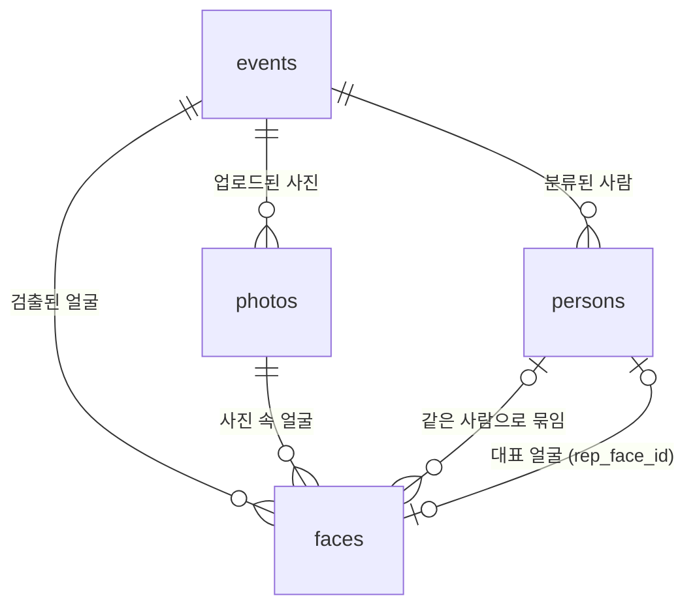

# ERD / DB 스키마

> 출처: Notion [백엔드 흐름](https://app.notion.com/p/3fb0ea4df78580f68c86d8936c86967c) (2026-10-26 동기화). 원본이 바뀌면 이 문서도 갱신.

DB는 **PostgreSQL + pgvector**. 별도 큐 리소스 없이 `photos.status`를 작업 큐로 쓴다.

## 관계도



## 상태값

| 컬럼 | 흐름 |
|---|---|
| `events.status` | `uploading` → `extracting` → `clustering` → `open` |
| `photos.status` | `uploaded` → `processing` → `extracted` / `failed` |

- `uploading → extracting`: 관리자가 업로드 완료 API 호출
- `extracting → clustering`: 해당 행사에 `uploaded`·`processing` 사진이 0장 (`failed`는 기다리지 않음)
- `clustering → open`: 분류 완료 + Object Storage 보관 완료

## DDL

```sql
CREATE EXTENSION IF NOT EXISTS vector;   -- pgvector

CREATE TABLE events (
  id           BIGSERIAL PRIMARY KEY,
  name         VARCHAR(100) NOT NULL,
  access_code  VARCHAR(16) UNIQUE NOT NULL,   -- 참가자 인증코드
  status       VARCHAR(20) NOT NULL DEFAULT 'uploading'
);

-- 사진 + 작업 큐 겸용
CREATE TABLE photos (
  id          BIGSERIAL PRIMARY KEY,
  event_id    BIGINT NOT NULL REFERENCES events(id),
  file_name   VARCHAR(255) NOT NULL,
  nas_path    TEXT NOT NULL,                  -- event1/IMG_0345.jpg (NAS_ROOT_PATH 기준 상대 경로)
  object_key  TEXT,                           -- Object Storage 보관 후 채움
  status      VARCHAR(20) NOT NULL DEFAULT 'uploaded',
  worker_id   VARCHAR(50),                    -- 작업을 잡은 워커
  claimed_at  TIMESTAMP                       -- 작업을 잡은 시각 (5분 초과 시 복구)
);

CREATE TABLE persons (
  id           BIGSERIAL PRIMARY KEY,
  event_id     BIGINT NOT NULL REFERENCES events(id),
  label        VARCHAR(50) NOT NULL,          -- 'user1' (폴더명)
  rep_face_id  BIGINT,                        -- 대표 얼굴 (faces.id)
  centroid     VECTOR(512) NOT NULL,          -- 매칭용 평균 벡터 (정규화)
  UNIQUE (event_id, label)
);

CREATE TABLE faces (
  id         BIGSERIAL PRIMARY KEY,
  photo_id   BIGINT NOT NULL REFERENCES photos(id),
  event_id   BIGINT NOT NULL REFERENCES events(id),
  bbox       JSONB NOT NULL,                  -- {"x":..,"y":..,"w":..,"h":..}
  embedding  VECTOR(512) NOT NULL,            -- 얼굴 벡터 (정규화)
  person_id  BIGINT REFERENCES persons(id)    -- 분류 전 NULL
);
```

`persons.rep_face_id`는 FK 제약 없이 둔다 (persons ↔ faces 순환 참조).

## 인덱스

```sql
CREATE INDEX idx_photos_queue  ON photos(status, id);         -- 워커 작업 잡기
CREATE INDEX idx_photos_event  ON photos(event_id, status);   -- 분류 시작 판단
CREATE INDEX idx_faces_event   ON faces(event_id);            -- 분류 시 행사 전체 얼굴 로드
CREATE INDEX idx_faces_person  ON faces(person_id);           -- 사람 폴더 조회
CREATE INDEX idx_faces_photo   ON faces(photo_id);            -- 사진별 얼굴 조회
```

## 워커 큐 규칙 (photos)

1. **작업 잡기**: `status='uploaded'` 1장을 `processing`으로 바꾸며 가져옴 (`worker_id`, `claimed_at` 기록). 여러 워커가 같은 행을 잡지 않도록 `FOR UPDATE SKIP LOCKED` 사용.
2. **완료**: `faces` INSERT + `photos.status='extracted'`를 **한 트랜잭션**으로.
3. **일시 오류**(DB 끊김 등): `status='uploaded'`, `worker_id=NULL`로 되돌림.
4. **워커 사망**: 웹서버가 `claimed_at` 5분 초과 `processing` 행을 3번과 같이 복구.
5. **영구 오류**(파일 없음·손상): `status='failed'`, `worker_id`는 추적용으로 남김. 관리자 화면 실패 목록에 노출.

## 분류 규칙 (persons)

> 구현하면서 정한 규칙 (2026-10-25). Notion "구현 반영 (2026-10-25)"에도 반영.

웹서버(API 서버)의 백그라운드 스케줄러가 5초마다 반복한다 (`backend/clustering/scheduler.py`).

1. **멈춘 사진 복구**: `claimed_at`이 DB 시계 기준 5분 넘은 `processing` 사진을 `uploaded`, `worker_id=NULL`, `claimed_at=NULL`로 되돌림 (워커 큐 규칙 4번).
2. **분류 시작**: `extracting` 행사 중 `uploaded`·`processing` 사진이 0장인 행사를 조건부 UPDATE 한 번으로 `clustering`으로 바꿈.
3. **분류**: 행사 얼굴 전체를 평균 연결(average linkage) 계층적 군집으로 묶음. 두 묶음의 평균 코사인 거리가 기준값(0.65) 이하일 때만 합침. 기준값은 Gallagher 589장 실험(0.75부터 다른 사람이 섞임)으로 정함.
   - 한 번만 나온 사람도 폴더 1개 (숨기는 건 API 10의 `minPhotos`)
   - `label`: 사진 수가 많은 사람부터 `user1`, `user2`, … (같은 입력이면 같은 순서)
   - `centroid`: 소속 얼굴 벡터 평균을 길이 1로 정규화
   - `rep_face_id`: 그 사람의 가장 큰 얼굴 면적의 50% 이상인 얼굴 중 `centroid`와 가장 닮은 얼굴
   - 다시 실행해도 안전: 이전 persons·`faces.person_id`를 지우고 한 트랜잭션으로 새로 만듦
4. **보관 → `open`**: 분류가 끝나면 `archive_and_open_event` 호출. 보관이 실패하면 `clustering`에 남고, 다음 주기에는 분류 없이 보관만 다시 함.

API 서버가 여러 대여도 같은 행사는 한 서버만 처리하도록 행사별 PostgreSQL advisory lock(`pg_try_advisory_lock(event_id)`)을 잡는다. 처리 중 서버가 죽으면 커넥션이 끊기면서 잠금이 풀려 다른 서버가 이어서 처리한다.

## 매칭 쿼리

셀카 벡터와 해당 행사 `persons.centroid`의 코사인 유사도 → 기준값 이상 상위 3명.

```sql
SELECT id, label, rep_face_id, 1 - (centroid <=> :selfie) AS sim
FROM persons WHERE event_id = :event_id
ORDER BY centroid <=> :selfie LIMIT 3;
```
